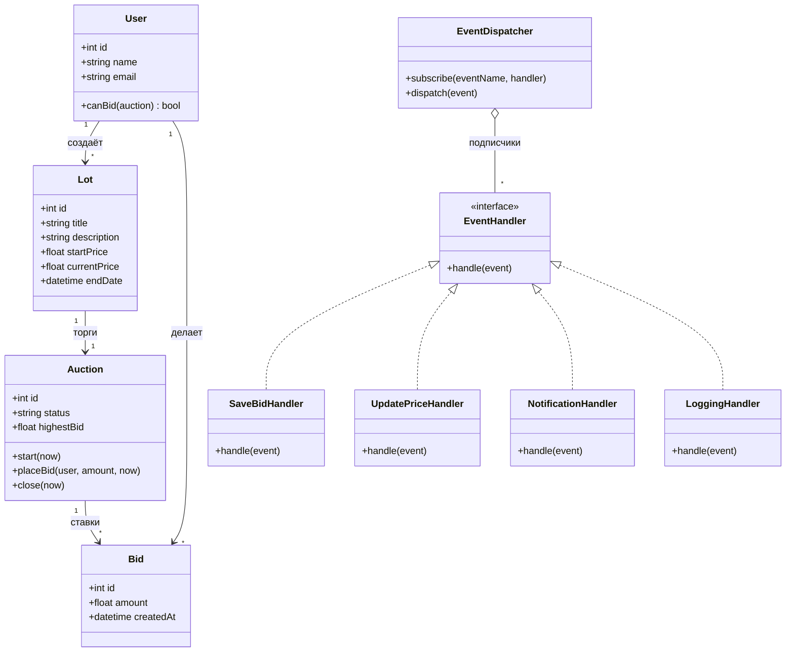
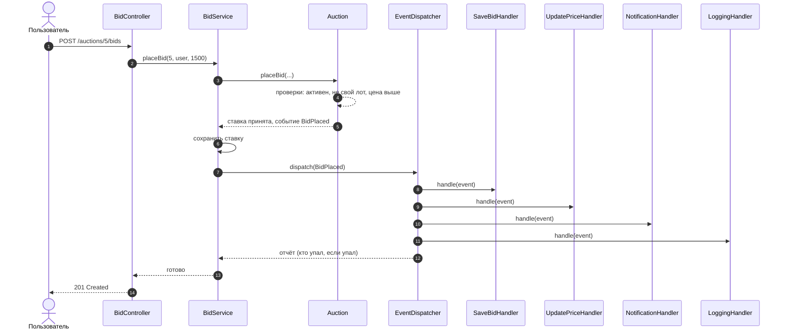
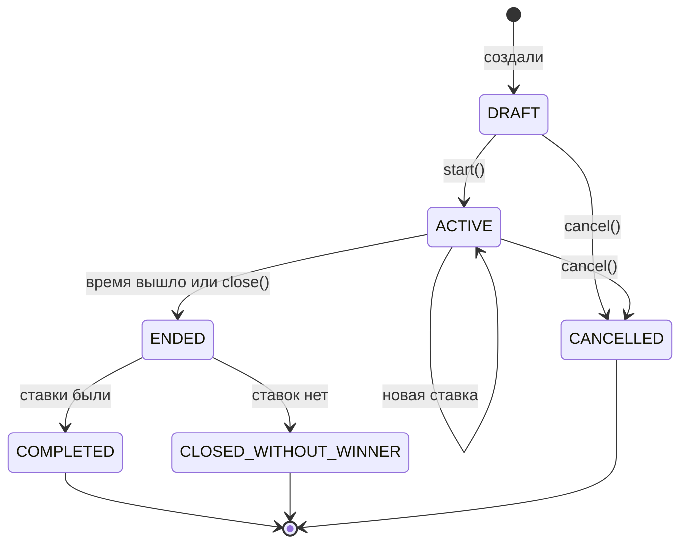

# Интернет-аукцион — лабораторная №5 (вариант 18)

Лаба по проектированию: надо придумать архитектуру сайта-аукциона и показать, что она построена
на событиях (**Event-Driven Architecture**). Кода на PHP здесь нет — только описание и UML-диаграммы
в Mermaid, которые GitHub рисует сам, без сторонних программ.

Коротко: люди выставляют лоты, другие делают ставки, система закрывает торги и говорит, кто победил.

---

## 1. Что вообще происходит на таком сайте

1. Пользователь создаёт лот: название, описание, стартовая цена, дата окончания.
2. По лоту создаётся аукцион. Пока время не пришло — он висит в черновике/расписании.
3. Когда торги открылись, другие пользователи делают ставки.
4. Каждая новая ставка должна быть выше предыдущей, иначе она не принимается.
5. Кто был лидером и его перебили — получает уведомление «вас перебили».
6. Когда время вышло, аукцион закрывается. Если ставки были — определяем победителя, если нет — закрываем без победителя.

## 2. Сущности

| Сущность | Что это простыми словами |
|---|---|
| `User` | Пользователь: имя, email. Может создавать лоты и делать ставки |
| `Lot` | Лот — сам товар: название, описание, стартовая и текущая цена |
| `Auction` | Торги по лоту: статус, время начала и конца, текущая максимальная ставка |
| `Bid` | Одна ставка: кто сделал, сколько, когда |

`Lot` — это «что продаём», `Auction` — «как и когда продаём», `Bid` — «сколько дали».
Разделяю специально: у лота есть цена и описание, у торгов — правила и время.

## 3. Правила торгов

1. Стартовая цена больше нуля, дата окончания позже даты начала.
2. Ставку можно делать только на активном аукционе и только до даты окончания.
3. Новая ставка должна быть строго больше текущей максимальной (первая — не ниже стартовой).
4. Автор лота не может делать ставку на свой же лот.
5. Каждая ставка сохраняется, ничего не перезаписывается.
6. Когда ставку перебили, предыдущий лидер получает уведомление.
7. Когда время вышло, аукцион закрывается и ставки больше не принимаются.
8. Победитель — тот, чья ставка последняя и максимальная. Если ставок нет, победителя не будет.

## 4. Почему события, а не «всё в одном методе»

Можно было бы написать один большой метод `placeBid()`, который сохраняет ставку, обновляет цену,
шлёт письмо и пишет в лог. Работает, но:

- метод разрастается, и в нём легко что-то сломать;
- чтобы добавить ещё одно действие, приходится лезть внутрь этого метода;
- if/else на «а если это первая ставка», «а если перебили» — и через месяц никто не помнит, что там происходит.

Поэтому сервис просто сохраняет ставку и говорит: «случилось событие `BidPlaced`».
Кто на него подписан — не его дело. Обработчики узнают о событии сами:

```text
BidPlaced ──> SaveBidHandler        (сохранить ставку в БД)
          ──> UpdatePriceHandler    (обновить текущую цену лота)
          ──> LoggingHandler        (записать в лог)

BidOutbid ──> NotificationHandler   (написать тому, кого перебили)
          ──> LoggingHandler        (записать в лог)
```

Обработчики **не знают друг о друге**: никто никого не вызывает, все получают одно и то же событие
и делают своё дело. Добавить пятый обработчик — значит просто подписать его на событие,
ничего в остальных не меняя. Это и есть главная идея лабы.

## 5. Слои приложения

| Слой | Что лежит |
|---|---|
| Presentation | контроллеры: приняли запрос, отдали ответ |
| Application | сервисы: `BidService`, `AuctionService`, планировщик закрытия |
| Domain | `User`, `Lot`, `Auction`, `Bid`, правила торгов, сами события |
| Infrastructure | БД, почта, логи, реализация диспетчера событий |

Зависимости идут сверху вниз, домен вообще не знает про БД и HTTP.

## 6. Диаграмма классов



Смысл картинки: `Auction` — центр домена, у него все ставки и текущий максимум.
`EventDispatcher` держит список подписчиков, а `EventHandler` — общий интерфейс для всех четырёх
обработчиков. Каждый обработчик реализует интерфейс и больше ни с кем не связан.

## 7. Как проходит одна ставка



Обратите внимание: после `dispatch` сервис не проверяет, кто именно подписан.
Он просто отправляет событие и живёт дальше.

## 8. Статусы аукциона



## 9. События

| Событие | Когда появляется | Кто слушает |
|---|---|---|
| `AuctionCreated` | создали аукцион по лоту | `NotificationHandler`, `LoggingHandler` |
| `BiddingStarted` | торги открылись | `NotificationHandler`, `LoggingHandler` |
| `BidPlaced` | приняли новую максимальную ставку | `SaveBidHandler`, `UpdatePriceHandler`, `LoggingHandler` |
| `BidOutbid` | новую ставку перебил другой пользователь | `NotificationHandler`, `LoggingHandler` |
| `AuctionEnded` | торги закрылись | `NotificationHandler`, `LoggingHandler` |
| `WinnerDetermined` | определили победителя | `NotificationHandler`, `LoggingHandler` |

У каждого события есть номер, время, id аукциона и данные внутри. Подробные поля — в
[`docs/events-catalog.md`](docs/events-catalog.md).

## 10. Обработчики

| Обработчик | Что делает | Что ему нужно |
|---|---|---|
| `SaveBidHandler` | сохраняет ставку в БД | `BidRepository` |
| `UpdatePriceHandler` | обновляет `Lot.currentPrice` | `LotRepository` |
| `NotificationHandler` | пишет письмо/уведомление | `UserRepository`, `NotificationSender` |
| `LoggingHandler` | пишет строку в лог | `Logger` |

Все четыре зависят только от своих интерфейсов и от события. Ни один не импортирует другой —
именно это и проверяется в задании.

## 11. Файлы в репозитории

```text
Lab5/
├── README.md                  ← этот файл
├── .gitignore
└── docs/
    ├── architecture.md        ← подробнее про классы, слои и обработчиков
    └── events-catalog.md      ← все события с полями и примерами JSON
```

## 12. Что не сделано

Реализации на PHP нет и не планировалось — в задании нужно только проектирование.
В [`docs/architecture.md`](docs/architecture.md) описано, как это разложилось бы по папкам,
если писать код.
