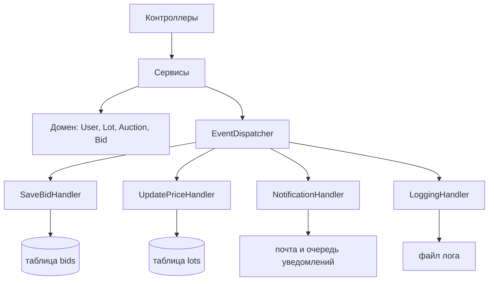

# Архитектура — подробнее

Здесь то, что не влезло в README: как устроены классы, что делает каждый обработчик,
кто за что отвечает и как это выглядело бы в коде.

## 1. Общая картина



Контроллер ничего не знает про базу, а домен ничего не знает ни про базу, ни про HTTP.
Всё, что надо наружу, идёт через сервисы.

## 2. Слои

| Слой | Классы | Задача |
|---|---|---|
| Presentation | `AuctionController`, `BidController` | принять запрос, проверить входные данные, вернуть ответ |
| Application | `BidService`, `AuctionService`, `AuctionScheduler` | сценарии: сделать ставку, создать аукцион, закрыть просроченные |
| Domain | `User`, `Lot`, `Auction`, `Bid`, события | правила торгов и данные |
| Infrastructure | репозитории, `EventDispatcher`, логгер, отправитель писем | работа с БД, почтой, файлами |

## 3. Классы

### User

Пользователь сайта.

| Поле | Тип | Зачем |
|---|---|---|
| `id` | int | идентификатор |
| `name` | string | имя для отображения |
| `email` | string | для уведомлений |
| `createdAt` | datetime | когда зарегистрировался |

Методы: `canBid(auction)` — можно ли этому пользователю делать ставку (например, не свой ли это лот).

### Lot

Сам товар.

| Поле | Тип | Зачем |
|---|---|---|
| `id` | int | идентификатор |
| `title`, `description` | string | название и описание |
| `startPrice` | float | стартовая цена |
| `currentPrice` | float | текущая цена (обновляется обработчиком) |
| `author` | User | кто выставил |
| `startDate`, `endDate` | datetime | когда торги идут |

`currentPrice` — это просто удобное поле для отображения. Решение «принимать ставку или нет»
принимает аукцион по своей максимальной ставке, а не по этому полю.

### Auction

Главный класс. Здесь все правила торгов.

| Поле | Тип | Зачем |
|---|---|---|
| `id` | int | идентификатор |
| `lot` | Lot | по какому лоту торги |
| `status` | string | `DRAFT`, `ACTIVE`, `ENDED` и т.д. |
| `highestBid` | Bid | текущая максимальная ставка |
| `bids` | Bid[] | все ставки |
| `winner` | User | победитель, если есть |

Методы:

- `start(now)` — открыть торги;
- `placeBid(user, amount, now)` — принять ставку, проверить правила, вернуть событие;
- `close(now)` — закрыть торги;
- `cancel(now)` — отменить;
- `determineWinner()` — выбрать победителя.

Все проверки собраны в `placeBid()`, потому что если разбросать их по сервисам,
рано или поздно две ставки одновременно пройдут проверку.

### Bid

Одна ставка.

| Поле | Тип | Зачем |
|---|---|---|
| `id` | int | идентификатор |
| `bidder` | User | кто сделал |
| `amount` | float | сколько |
| `createdAt` | datetime | когда |
| `status` | string | `WINNING`, `OUTBID`, `WON` |

## 4. События

Все события — простые неизменяемые объекты. Общие поля у всех одинаковые:

| Поле | Что это |
|---|---|
| `eventId` | уникальный номер события |
| `eventName` | например `BidPlaced` |
| `occurredAt` | когда случилось |
| `auctionId` | к какому аукциону относится |

Остальные поля зависят от события — они расписаны в
[`events-catalog.md`](events-catalog.md).

Событие создаётся внутри домена (в `Auction`) и складывается в список `recordedEvents`.
Сервис после сохранения забирает этот список и отправляет в диспетчер. Так домен
не зависит от того, есть ли вообще подписчики.

## 5. Диспетчер событий

Это единственное место, где кто-то знает про подписчиков.

```text
subscribe("BidPlaced", saveBidHandler)
subscribe("BidPlaced", updatePriceHandler)
subscribe("BidPlaced", loggingHandler)
...
dispatch(new BidPlaced(...))
```

Что делает `dispatch(event)`:

1. берёт имя события;
2. находит список подписчиков;
3. вызывает у каждого `handle(event)`;
4. если кто-то кинул исключение — записывает это в отчёт и идёт к следующему;
5. возвращает отчёт сервису.

Почему ошибка одного обработчика не должна ломать остальные: если упало отправка письма,
ставку всё равно надо сохранить и лог всё равно надо записать.

Подписка выполняется один раз при запуске приложения, в одном месте (там, где собирается
приложение: `index.php` или bootstrap). Внутри обработчиков никаких `subscribe` нет.

## 6. Обработчики

| Обработчик | События | Что делает | Зависимости |
|---|---|---|---|
| `SaveBidHandler` | `BidPlaced` | сохраняет ставку в таблицу `bids` | `BidRepository` |
| `UpdatePriceHandler` | `BidPlaced` | пишет новую цену в `lots.current_price` | `LotRepository` |
| `NotificationHandler` | `AuctionCreated`, `BiddingStarted`, `BidOutbid`, `AuctionEnded`, `WinnerDetermined` | отправляет уведомление участнику | `UserRepository`, `NotificationSender` |
| `LoggingHandler` | все шесть | пишет строку в лог: кто, что, когда | `Logger` |

У каждого обработчика есть метод `handle(event)` и метод `subscribedTo()`, который
возвращает список имён событий. Диспетчеру этого достаточно.

Никаких `new SaveBidHandler()` внутри других обработчиков нет. Это и есть требование
«обработчики независимы».

## 7. Сервисы

### BidService

Сценарий «сделать ставку»:

1. достать аукцион из репозитория;
2. проверить, что он активен и время не вышло;
3. вызвать `auction.placeBid(...)` — там проверки и создание события;
4. сохранить аукцион и ставку;
5. отправить события в диспетчер.

### AuctionService

Создание аукциона, открытие торгов, закрытие, отмена. Тоже заканчивается отправкой событий.

### AuctionScheduler

Запускается по cron раз в минуту: находит аукционы, у которых прошло `endDate`,
и закрывает их. Это единственный «фоновый» кусок.

## 8. Репозитории

Репозиторий — это просто интерфейс для работы с базой, чтобы домен не знал про SQL.

| Интерфейс | Методы |
|---|---|
| `AuctionRepository` | `save`, `findById`, `findExpired`, `lockById` |
| `BidRepository` | `save`, `findByAuction`, `findHighest` |
| `LotRepository` | `findById`, `updateCurrentPrice` |
| `UserRepository` | `findById`, `findByEmail` |

В коде это были бы `PdoAuctionRepository` и подобные классы в папке `Infrastructure`.

## 9. Модель данных

```text
users (id, name, email, created_at)

lots (id, title, description, start_price, current_price, author_id, start_date, end_date)

auctions (id, lot_id, status, highest_bid_id, winner_id, created_at, started_at, ended_at)

bids (id, auction_id, bidder_id, amount, status, created_at)

events_log (id, event_id, event_name, payload, created_at)   -- для аудита и отладки
```

## 10. Что если что-то упало

| Где упало | Что делаем |
|---|---|
| Проверка ставки | ставка не создаётся, пользователь видит ошибку |
| Сохранение ставки | транзакция откатывается, события не отправляются |
| `SaveBidHandler` | ошибка пишется в отчёт, остальные обработчики работают |
| `UpdatePriceHandler` | цена обновится при следующей ставке, критичного ничего нет |
| `NotificationHandler` | уведомление уходит в очередь и отправляется позже |

Общее правило: сначала сохранили данные, потом отправили события. Наоборот делать нельзя —
подписчик может сходить в базу и не найти там ставку.

## 11. Как это выглядело бы в PHP

```text
src/
├── Domain/
│   ├── User.php, Lot.php, Auction.php, Bid.php
│   └── Event/
│       ├── DomainEvent.php
│       ├── AuctionCreated.php
│       ├── BiddingStarted.php
│       ├── BidPlaced.php
│       ├── BidOutbid.php
│       ├── AuctionEnded.php
│       └── WinnerDetermined.php
├── Application/
│   ├── BidService.php
│   ├── AuctionService.php
│   └── AuctionScheduler.php
├── Infrastructure/
│   ├── Event/
│   │   ├── EventDispatcher.php
│   │   └── EventHandler.php
│   ├── Handler/
│   │   ├── SaveBidHandler.php
│   │   ├── UpdatePriceHandler.php
│   │   ├── NotificationHandler.php
│   │   └── LoggingHandler.php
│   └── Repository/
│       ├── PdoAuctionRepository.php
│       ├── PdoBidRepository.php
│       └── PdoLotRepository.php
└── Presentation/
    ├── AuctionController.php
    └── BidController.php
```

## 12. Что проверяет преподаватель

| Требование варианта 18 | Где смотреть |
|---|---|
| Сущности `User`, `Auction`, `Lot`, `Bid` | README, раздел 6 |
| Шесть событий | README, раздел 9 и `events-catalog.md` |
| Четыре независимых обработчика | README, раздел 10 и раздел 6 этого файла |
| `EventDispatcher` / `EventBus` | раздел 5 этого файла |
| Обработчики не знают друг о друге | README, раздел 4, схема подписок |
| UML-диаграммы | README, разделы 6–8 + схема в разделе 1 |
| Нет PHP-кода | во всём репозитории только Markdown |
