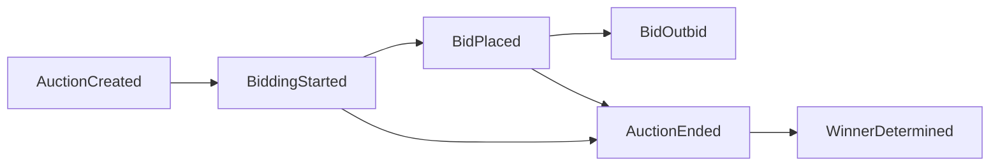

# События

Событий всего шесть. Они идут в таком порядке:



`BidPlaced` и `AuctionEnded` могут повторяться много раз, `AuctionCreated` и `BiddingStarted`
бывают один раз на аукцион. `WinnerDetermined` появляется только если ставки были.

## Общие поля

У всех событий одинаковый «конверт»:

| Поле | Тип | Что это |
|---|---|---|
| `eventId` | string | уникальный номер, например `uuid` |
| `eventName` | string | имя события |
| `occurredAt` | string | время в формате ISO 8601, UTC |
| `auctionId` | int | к какому аукциону относится |

Дальше у каждого события свои поля.

---

## 1. AuctionCreated

Появляется, когда пользователь создал аукцион по лоту.

| Поле | Тип | Что это |
|---|---|---|
| `lotId` | int | id лота |
| `authorId` | int | кто создал |
| `title` | string | название лота |
| `startPrice` | float | стартовая цена |
| `startDate` | string | когда начнутся торги |
| `endDate` | string | когда закончатся |

Слушают: `NotificationHandler` (письмо автору «аукцион создан»), `LoggingHandler`.

```json
{
  "eventId": "6f1c2a9e-1e0e-4a51-9a1e-3a1f0c7b2d10",
  "eventName": "AuctionCreated",
  "occurredAt": "2026-11-17T10:00:00Z",
  "auctionId": 5,
  "lotId": 12,
  "authorId": 3,
  "title": "Велосипед Stels",
  "startPrice": 5000.00,
  "startDate": "2026-11-17T12:00:00Z",
  "endDate": "2026-11-20T12:00:00Z"
}
```

---

## 2. BiddingStarted

Торги открылись.

| Поле | Тип | Что это |
|---|---|---|
| `lotId` | int | id лота |
| `startedAt` | string | время открытия |
| `endDate` | string | время закрытия |

Слушают: `NotificationHandler`, `LoggingHandler`.

```json
{
  "eventId": "b3d0c1a4-77e2-4d4c-8f9a-0c2b5d6e7f81",
  "eventName": "BiddingStarted",
  "occurredAt": "2026-11-17T12:00:00Z",
  "auctionId": 5,
  "lotId": 12,
  "startedAt": "2026-11-17T12:00:00Z",
  "endDate": "2026-11-20T12:00:00Z"
}
```

---

## 3. BidPlaced

Приняли новую максимальную ставку. Самое главное событие.

| Поле | Тип | Что это |
|---|---|---|
| `bidId` | int | id новой ставки |
| `bidderId` | int | кто поставил |
| `amount` | float | сумма ставки |
| `previousAmount` | float | какая была цена до неё |
| `bidCount` | int | сколько всего ставок на аукционе |
| `placedAt` | string | время ставки |

Слушают: `SaveBidHandler` (сохранить), `UpdatePriceHandler` (обновить цену лота),
`LoggingHandler`.

```json
{
  "eventId": "0d9f7e21-8c33-4a2b-b7f1-55e0a1c9d423",
  "eventName": "BidPlaced",
  "occurredAt": "2026-11-18T09:14:00Z",
  "auctionId": 5,
  "bidId": 77,
  "bidderId": 8,
  "amount": 7300.00,
  "previousAmount": 7000.00,
  "bidCount": 4,
  "placedAt": "2026-11-18T09:14:00Z"
}
```

---

## 4. BidOutbid

Кого-то перебили. Появляется вместе с `BidPlaced`, но только если до этого был лидер.

| Поле | Тип | Что это |
|---|---|---|
| `outbidUserId` | int | кого перебили |
| `outbidBidId` | int | его ставка |
| `newBidId` | int | ставка, которая перебила |
| `newAmount` | float | новая цена |
| `previousAmount` | float | старая цена |

Слушают: `NotificationHandler` (письмо «вас перебили»), `LoggingHandler`.

```json
{
  "eventId": "a1c4e5f0-2b3d-4c5e-9f70-112233445566",
  "eventName": "BidOutbid",
  "occurredAt": "2026-11-18T09:14:00Z",
  "auctionId": 5,
  "outbidUserId": 4,
  "outbidBidId": 76,
  "newBidId": 77,
  "newAmount": 7300.00,
  "previousAmount": 7000.00
}
```

---

## 5. AuctionEnded

Торги закрылись.

| Поле | Тип | Что это |
|---|---|---|
| `reason` | string | `TIME` (время вышло) или `CANCELLED` (отменили) |
| `bidCount` | int | сколько было ставок |
| `hasBids` | bool | были ли ставки вообще |
| `finalPrice` | float | финальная цена |

Слушают: `NotificationHandler`, `LoggingHandler`.

```json
{
  "eventId": "5e6f7a8b-9c0d-4e1f-8a2b-3c4d5e6f7a8b",
  "eventName": "AuctionEnded",
  "occurredAt": "2026-11-20T12:00:00Z",
  "auctionId": 5,
  "reason": "TIME",
  "bidCount": 4,
  "hasBids": true,
  "finalPrice": 7300.00
}
```

---

## 6. WinnerDetermined

Определили победителя. Появляется после `AuctionEnded` и только если `hasBids = true`.

| Поле | Тип | Что это |
|---|---|---|
| `winnerId` | int | победитель |
| `winningBidId` | int | его ставка |
| `finalPrice` | float | за сколько продали |

Слушают: `NotificationHandler` (письма победителю и автору), `LoggingHandler`.

```json
{
  "eventId": "c7d8e9f0-1a2b-4c3d-9e4f-5a6b7c8d9e0f",
  "eventName": "WinnerDetermined",
  "occurredAt": "2026-11-20T12:00:01Z",
  "auctionId": 5,
  "winnerId": 8,
  "winningBidId": 77,
  "finalPrice": 7300.00
}
```

---

## Кто на что подписан

| Обработчик | События |
|---|---|
| `SaveBidHandler` | `BidPlaced` |
| `UpdatePriceHandler` | `BidPlaced` |
| `NotificationHandler` | `AuctionCreated`, `BiddingStarted`, `BidOutbid`, `AuctionEnded`, `WinnerDetermined` |
| `LoggingHandler` | все шесть |

Подписка делается в одном месте при запуске приложения:

```text
dispatcher.subscribe("AuctionCreated",  notificationHandler)
dispatcher.subscribe("AuctionCreated",  loggingHandler)
dispatcher.subscribe("BiddingStarted",  notificationHandler)
dispatcher.subscribe("BiddingStarted",  loggingHandler)
dispatcher.subscribe("BidPlaced",       saveBidHandler)
dispatcher.subscribe("BidPlaced",       updatePriceHandler)
dispatcher.subscribe("BidPlaced",       loggingHandler)
dispatcher.subscribe("BidOutbid",       notificationHandler)
dispatcher.subscribe("BidOutbid",       loggingHandler)
dispatcher.subscribe("AuctionEnded",    notificationHandler)
dispatcher.subscribe("AuctionEnded",    loggingHandler)
dispatcher.subscribe("WinnerDetermined", notificationHandler)
dispatcher.subscribe("WinnerDetermined", loggingHandler)
```

Именно поэтому обработчики независимы: они не вызывают друг друга, а просто каждый
подписан на то, что ему нужно.

## Мелочи

- **Порядок.** Обработчики не должны зависеть от порядка вызова, поэтому каждый
  сначала проверяет, не делал ли он уже это (по `eventId`).
- **Повторы.** Если событие пришло дважды (например, из-за повторной отправки), второй раз
  ничего не меняем: ставка с тем же `eventId` уже есть.
- **Ошибки.** Если обработчик упал, диспетчер пишет ошибку в лог и вызывает следующий.
  Ставка при этом уже сохранена — терять её из-за письма нельзя.
